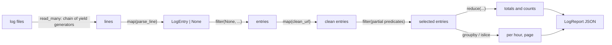

# Log File Analyzer

A command-line tool that parses web server access logs (Apache/Nginx) with
regular expressions and turns them into an analytics report. The processing
is written in a functional style (`map`, `filter`, `reduce`, `partial`),
files are streamed with generators, `itertools` groups and windows the
entries, and decorators add timing, caching and call tracing.


## Table of contents

1. [Features](#features)
2. [Setup](#setup)
3. [Usage](#usage)
4. [Sample output](#sample-output)
5. [JSON report example](#json-report-example)
6. [Regex patterns](#regex-patterns)
7. [Functional pipeline](#functional-pipeline)
8. [Generators and itertools](#generators-and-itertools)
9. [Decorators](#decorators)
10. [Generator vs. list performance](#generator-vs-list-performance)
11. [Testing](#testing)
12. [Project structure](#project-structure)
13. [Git workflow](#git-workflow)

## Features

- Parses the **common** and **combined** log formats with compiled regex
  patterns and named groups; bad lines are skipped and counted
- Validates IP addresses, emails and URLs; cleans data with `re.sub()`
- Filters by status code, errors only, HTTP method and time window
- Aggregates with `reduce()`: requests, bytes, error rate, counts per status,
  method, IP and URL, unique URLs, top IPs and URLs
- Groups requests per hour and errors per status with `itertools.groupby()`
- Reads one or many files lazily (`yield`, `itertools.chain`) in batches
- `@timer`, `@cache` (`functools.lru_cache`) and `@log_call` decorators
- JSON report and bordered terminal output
- 180 tests, 100 % line and branch coverage, mypy strict, pre-commit hooks

## Setup

Requires Python 3.11+.

```bash
git clone https://github.com/Molyceo12/AmaliTech_Python_Backend_Labs.git
cd AmaliTech_Python_Backend_Labs/ADVANCED_PYTHON/log-file-analyzer

# with Poetry (creates .venv/ inside the project)
python -m pip install poetry
python -m poetry install
```

Without Poetry (`requirements.txt` is the pinned list exported from Poetry;
the tool itself only uses the standard library):

```bash
python -m venv .venv
.venv\Scripts\activate            # Linux/macOS: source .venv/bin/activate
python -m pip install -r requirements.txt
python -m pip install -e .
```

## Usage

```bash
python -m poetry run log-analyzer data/access.log
python -m poetry run log-analyzer data/access.log data/access_2.log --errors-only --top 3
python -m poetry run log-analyzer data/access.log --from 2026-10-20T09:00 --to 2026-10-20T12:00 --page 2 --per-page 10
```

| Option | Default | Meaning |
|---|---|---|
| `paths` (1 or more) | — | log files, read in this order |
| `-o`, `--output` | `output/report.json` | JSON report to write |
| `--status CODE` | all | keep only this status code (repeat for more) |
| `--errors-only` | off | keep only 4xx/5xx responses |
| `--method` | all | keep only one HTTP method, e.g. `GET` |
| `--from`, `--to` | none | time window, ISO 8601 (no timezone = UTC) |
| `--top` | `5` | top IPs and URLs to list |
| `--page`, `--per-page` | `1`, `20` | which entries the report lists |
| `-v`, `--verbose` | off | show the `@timer` and `@log_call` messages |

Exit codes: `0` success, `1` the analysis failed (file missing, unreadable,
report not writable), `2` bad command-line value (from `argparse`).

Sample logs in `data/`: `access.log` (1,200 lines), `access_2.log` (300 lines,
the next day) and `malformed.log` (10 lines, 4 valid). They are built by
`scripts/generate_logs.py` with a fixed random seed.

## Sample output

```
$ python -m poetry run log-analyzer data/access.log data/access_2.log --top 3
::::::::::::::::::::::::::::::::::::::::::::::::::::::::::::::::::::::::::::::::::::::::::::::::::
::  Log File Analyzer                                                                           ::
::::::::::::::::::::::::::::::::::::::::::::::::::::::::::::::::::::::::::::::::::::::::::::::::::
::  1. Reading 2 file(s) ........................ done (1,500 lines, 0 skipped)                 ::
::  2. Filtering the entries .................... done (1,500 entries match)                    ::
::  3. Building the report ...................... done (24 hour(s), 12 status code(s))          ::
::  4. Writing the JSON report .................. done (1 file)                                 ::
::::::::::::::::::::::::::::::::::::::::::::::::::::::::::::::::::::::::::::::::::::::::::::::::::

::::::::::::::::::::::::::::::::::::::::::::::::::::::::::::::::::::::::::::::::::::::::::::::::::
::  Summary                                                                                     ::
::::::::::::::::::::::::::::::::::::::::::::::::::::::::::::::::::::::::::::::::::::::::::::::::::
::  1. Requests analyzed: 1,500 (0 lines skipped)                                               ::
::  2. Errors: 394 (26.3 %)                                                                     ::
::  3. Busiest hour: 16:00 (75 requests)                                                        ::
::  4. Report saved to output\report.json                                                       ::
::  5. Run time: 0.078 s                                                                        ::
::  6. Top IPs:                                                                                 ::
::       192.168.1.17 (60 requests)                                                             ::
::       192.168.1.37 (58 requests)                                                             ::
::       198.51.100.23 (57 requests)                                                            ::
::::::::::::::::::::::::::::::::::::::::::::::::::::::::::::::::::::::::::::::::::::::::::::::::::
```

A missing file stops the run with a clear message (exit code 1):

```
$ python -m poetry run log-analyzer data/missing.log
Error: Log file not found: data\missing.log
```

## JSON report example

`output/report.json` from the run above (shortened):

```json
{
  "files": ["data/access.log", "data/access_2.log"],
  "total_lines": 1500,
  "parsed_lines": 1500,
  "skipped_lines": 0,
  "filters": {},
  "summary": {
    "total_requests": 1500,
    "total_bytes": 35507349,
    "error_count": 394,
    "error_rate": 26.3,
    "requests_per_status": { "200": 796, "404": 113, "500": 50, "...": "..." },
    "requests_per_method": { "PUT": 116, "POST": 236, "GET": 998, "DELETE": 150 },
    "top_ips": [{ "name": "192.168.1.17", "count": 60 }, "..."],
    "top_urls": [{ "name": "/contact", "count": 109 }, "..."],
    "unique_urls": 18
  },
  "requests_per_hour": { "00": 57, "01": 60, "02": 70, "03": 63, "...": "..." },
  "errors_by_status": { "400": 59, "401": 62, "403": 52, "404": 113, "500": 50, "503": 58 },
  "page": {
    "number": 1,
    "per_page": 20,
    "entries": [
      {
        "ip": "192.168.1.18",
        "timestamp": "2026-10-20T00:00:53+00:00",
        "method": "PUT",
        "url": "/contact",
        "protocol": "HTTP/1.1",
        "status": 200,
        "size": 44537,
        "referrer": null,
        "user_agent": "Mozilla/5.0 (X11; Linux x86_64) Firefox/131.0"
      }
    ]
  }
}
```

The shape of every section is a `TypedDict` in `models/report.py`.

## Regex patterns

### Log formats (`patterns/log_patterns.py`)

```
Common:   192.168.1.10 - - [21/Oct/2026:13:55:36 +0000] "GET /index.html HTTP/1.1" 200 2326
Combined: (common) "https://example.com/" "Mozilla/5.0 (X11; Linux x86_64)"
```

The patterns are compiled once with `re.compile(..., re.VERBOSE)`, so each
part sits on its own line with a comment. In verbose mode spaces are
ignored, so a real space is written as `[ ]`.

```python
_COMMON_FIELDS = r"""
    (?P<ip>\d{1,3}(?:\.\d{1,3}){3})       # client IPv4, e.g. 192.168.1.10
    [ ]\S+[ ]\S+                          # identity and user, usually "- -"
    [ ]\[(?P<timestamp>[^\]]+)\]          # [21/Oct/2026:13:55:36 +0000]
    [ ]"(?P<method>[A-Z]+)                # "GET
    [ ](?P<url>\S+)                       # /index.html?page=2
    [ ](?P<protocol>HTTP/\d(?:\.\d)?)"    # HTTP/1.1"
    [ ](?P<status>\d{3})                  # 200
    [ ](?P<size>\d+|-)                    # 2326, or - when no body was sent
"""
_COMBINED_EXTRA = r"""
    [ ]"(?P<referrer>[^"]*)"              # "https://example.com/" (may be "-")
    [ ]"(?P<user_agent>[^"]*)"            # "Mozilla/5.0 ..."
"""
COMMON_LOG = re.compile(_COMMON_FIELDS + r"$", re.VERBOSE)
COMBINED_LOG = re.compile(_COMMON_FIELDS + _COMBINED_EXTRA + r"$", re.VERBOSE)
```

| Named group | Pattern | Matches | Example |
|---|---|---|---|
| `ip` | `\d{1,3}(?:\.\d{1,3}){3}` | four dot-separated numbers; `(?:...)` groups without capturing | `192.168.1.10` |
| `timestamp` | `\[([^\]]+)\]` | everything between `[` and `]` | `21/Oct/2026:13:55:36 +0000` |
| `method` | `[A-Z]+` | upper-case letters only | `GET` |
| `url` | `\S+` | no spaces | `/search?q=python` |
| `protocol` | `HTTP/\d(?:\.\d)?` | `HTTP/1.0`, `HTTP/1.1`, `HTTP/2` | `HTTP/1.1` |
| `status` | `\d{3}` | exactly three digits | `404` |
| `size` | `\d+\|-` | bytes, or `-` for none | `2326` |
| `referrer` | `[^"]*` | anything inside the quotes | `https://example.com/` |
| `user_agent` | `[^"]*` | anything inside the quotes | `Mozilla/5.0 ...` |

- `match.groupdict()` gives every field by name, so the parser never uses
  group numbers.
- The combined pattern is tried first (`LOG_FORMATS`); `$` at the end makes
  each pattern reject the other format.
- `TIMESTAMP_FORMAT = "%d/%b/%Y:%H:%M:%S %z"` turns the timestamp into a
  timezone-aware `datetime`; an impossible date (day 32) is a skipped line.

### Validation (`patterns/validators.py`)

| Pattern | Rule |
|---|---|
| IP | each octet `(?:25[0-5]\|2[0-4]\d\|1\d\d\|[1-9]?\d)`: 0–255, no leading zeros; `\b` word boundaries |
| Email | `name@` + one or more domain labels + a 2+ letter top-level domain |
| URL | `http://` or `https://`, host labels, optional `:port`, optional path |

### Which `re` method is used where

| Method | Used for | Function |
|---|---|---|
| `re.compile` | build each pattern once | every pattern constant |
| `match` | a log line must start with the pattern | `parse_line` |
| `fullmatch` | the whole text must be valid | `is_valid_ip`, `is_valid_email`, `is_valid_url` |
| `search` | first address anywhere in a text | `find_ip` |
| `findall` | every address in a text | `find_all_ips` |
| `sub` | clean data | `strip_query_string` (`\?.*$`), `mask_emails`, `normalize_whitespace` (`\s+`) |

## Functional pipeline



The same flow as text:

```
lines ─ map(parse_line) ─► LogEntry|None ─ filter(None) ─► entries ─ map(clean_url) ─►
      ─ filter(only_errors / by_method / ...) ─► selected ─ reduce(...) ─► summary ─► JSON
```

| Tool | Where | Example |
|---|---|---|
| `map()` | `pipeline/transforms.py` | `parse_entries = filter(None, map(parse_line, lines))`, `to_records` |
| `filter()` | `pipeline/filters.py` | `select(only_errors, entries)`, `select_all([...], entries)` |
| `functools.partial()` | `pipeline/filters.py`, `pipeline/aggregations.py` | `only_errors = partial(by_status_range, 400, 599)`, `requests_per_ip = partial(count_by, attrgetter("ip"))` |
| `functools.reduce()` | `pipeline/aggregations.py` | `total_bytes`, `count_by`, `unique_urls` |
| `pipe` / `compose` | `pipeline/pipeline.py` | `pipe(lines, parse_entries, clean_urls, partial(select, only_errors), list)` |

Design choices:

- Predicates take their **settings first and the entry last**, so `partial`
  can fix the settings and leave a one-argument function for `filter`.
- `pipe(value, *steps)` is itself a `reduce`: each step receives the result
  of the previous one, so a pipeline reads left to right.
- Every transform returns a lazy iterator. `summarize` turns the entries
  into a list once, because several aggregations read the same data.
- `count_by` updates its accumulator in place inside `reduce`, so counting
  stays O(n) instead of copying a dict for every entry.

## Generators and itertools

| Tool | Where | Why |
|---|---|---|
| `yield` | `readers/log_reader.read_lines` | one line at a time; the file is opened only when the first line is needed |
| `@contextmanager` | `readers/log_reader.open_log` | always closes the file; turns `OSError`s into clear `LogFileError`s |
| `itertools.chain` | `readers/log_reader.read_many` | several files as one stream, opened one after another |
| custom iterator | `readers/batching.Batches` | `__iter__`/`__next__` hand out lists of n items; the service parses 500 lines at a time |
| `itertools.groupby` | `pipeline/windowing.grouped` | requests per hour, errors per status; sorts first because `groupby` only groups neighbours |
| `itertools.islice` | `pipeline/windowing.paginate`, `Batches` | one page or batch without building the others |
| `itertools.takewhile` / `dropwhile` | `pipeline/windowing.until`, `time_window` | stop reading as soon as the time window ends (entries are sorted by time first) |

## Decorators

| Decorator | File | Behaviour |
|---|---|---|
| `@timer` | `decorators/timing.py` | logs `run took 0.078 s` (INFO) and keeps the time for `last_duration(func)` |
| `@cache` | `decorators/caching.py` | wraps `functools.lru_cache`; works as `@cache` or `@cache(maxsize=256)`; keeps `cache_info()` |
| `@log_call` | `decorators/tracing.py` | logs the call with shortened arguments (`reprlib`) and the result (DEBUG) |

All three use `functools.wraps`, so the decorated function keeps its name
and docstring. Where they are used:

```python
@cache                      # parsing/parser.py: repeated timestamps are parsed once
def parse_timestamp(text: str) -> datetime: ...

class AnalyzerService:
    @timer                  # outer: the time includes the tracing below
    @log_call               # inner: runs closest to the real function
    def run(self, paths, output, options=None) -> AnalysisResult: ...
```

Decorators apply bottom-up: `run = timer(log_call(run))`. Calling `run`
enters `timer` first, then `log_call`, then the method. Run with `-v` to see
both messages.

## Generator vs. list performance

Same job, two ways: count the error responses in a log built from 100
copies of `data/access.log` (120,000 lines).

```bash
python -m poetry run python -m log_analyzer.utils.memory --copies 100
```

| Approach | Errors counted | Peak memory | Time |
|---|---:|---:|---:|
| list (load everything) | 30,500 | 82,143 KiB | 5.245 s |
| generator (line by line) | 30,500 | 413 KiB | 4.390 s |

The generator used **199x less memory** for the same answer.
`sys.getsizeof`: a list of all entries is 1,013,816 bytes (just the list,
not the entries inside it); the generator object is 48 bytes, whatever the
file size.

Measured on Windows 11, Python 3.14. Peak memory comes from `tracemalloc`;
the time comes from a separate run without `tracemalloc`, because tracing
slows Python down a lot. The timestamp cache is cleared before each run.

What the numbers show:

- **Memory:** the list version keeps every line and every entry; its peak
  grows with the file. The generator holds one line at a time, so its peak
  stays flat (about 400 KiB) whatever the file size.
- **Time:** both do the same parsing work, so times are close; the
  generator is a little faster because it never builds the big lists.
- **When a list is right:** when the same data is needed several times.
  `summarize` does this on purpose: it makes one list of the *filtered*
  entries, then runs every aggregation on it.

## Testing

```bash
python -m poetry run pytest                                   # all tests
python -m poetry run pytest --cov --cov-report=term-missing   # with coverage
python -m poetry run python -m pre_commit run --all-files     # Black, ruff, pylint, mypy
```

| Folder | What is tested |
|---|---|
| `tests/unit/` | log patterns and every named group, validators, cleaning, parser, model, sample data, transforms, filters and `partial`, aggregations, pipeline, reader (lazy, errors), batching iterator, itertools helpers, decorators (with `caplog`), options, service, JSON writer, terminal boxes, generator memory |
| `tests/integration/` | the CLI on the real sample files: report, two chained files, filter options, exit codes 0 / 1 / 2 |

180 tests, 100 % line and branch coverage (`reports/coverage.txt`).
Regex tests use `pytest.mark.parametrize` with readable `ids` (e.g.
`4-digit status`, `lowercase method`) for every bad line.

## Project structure

```
log-file-analyzer/
├── src/log_analyzer/
│   ├── cli.py                  # command line (argparse, exit codes)
│   ├── console.py              # bordered terminal output
│   ├── exceptions.py           # LogAnalyzerError and subclasses
│   ├── models/                 # LogEntry dataclass, report TypedDicts
│   ├── patterns/               # log formats, validators, re.sub cleaning
│   ├── parsing/                # line → LogEntry (cached timestamps)
│   ├── readers/                # generators, chain, Batches iterator
│   ├── pipeline/               # map transforms, filters, reduce, pipe, itertools
│   ├── decorators/             # @timer, @cache, @log_call
│   ├── services/               # AnalyzerService, AnalyzerOptions
│   ├── writers/                # JSON report writer
│   └── utils/memory.py         # generator vs. list comparison
├── scripts/generate_logs.py    # builds the sample logs (fixed seed)
├── tests/                      # unit/ and integration/
├── data/                       # sample logs
├── reports/coverage.txt
├── pyproject.toml, poetry.lock, requirements.txt
├── CHANGELOG.md
└── README.md
```

## Git workflow

The repository is shared by several labs, so every branch of this lab starts
with `log-analyzer/` and merges into the shared `main` through a pull request:

| Branch | Content |
|---|---|
| `log-analyzer/feature/regex-parsing` | project setup, regex patterns, validators, parser, sample logs |
| `log-analyzer/feature/functional-pipeline` | map / filter / reduce / partial, pipeline helper |
| `log-analyzer/feature/generators-decorators` | generators, iterator, itertools, decorators, service, CLI |
| `log-analyzer/feature/tests-docs` | memory comparison, documentation |

Release tag: `log-analyzer-v1.0.0`.
