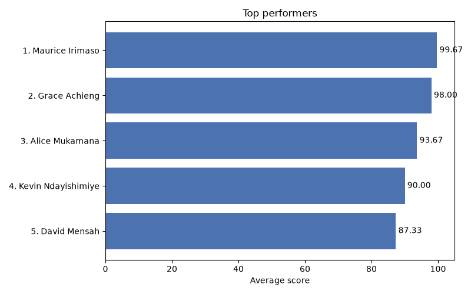
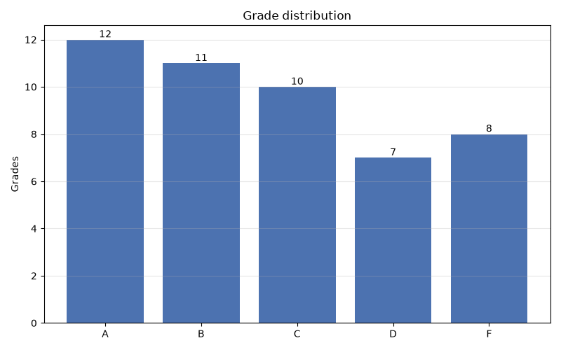
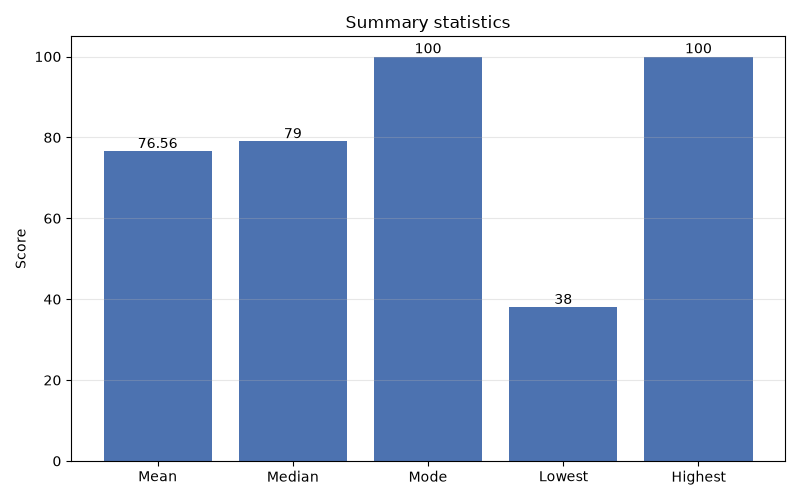
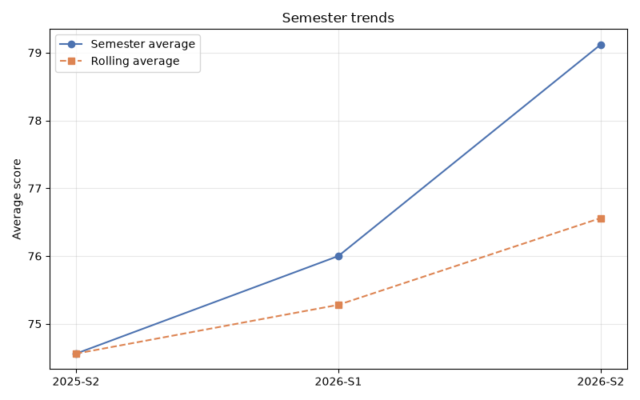
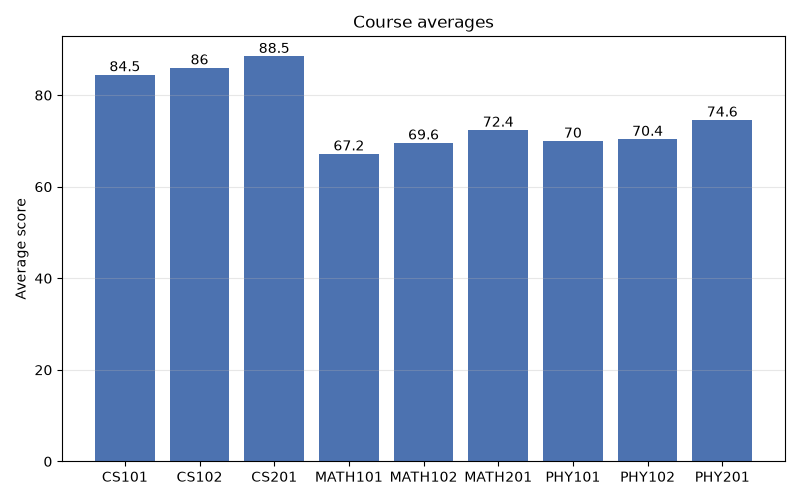

# Student Grade Analytics Tool

A command-line tool that reads student grades from a CSV file, calculates
statistics (averages, distributions, percentile rankings, semester trends) and
writes a JSON report plus PNG charts. Built with Python's advanced collections
(`Counter`, `defaultdict`, `OrderedDict`, `deque`), dataclasses, namedtuples and
full type hints.


## Table of contents

1. [Features](#features)
2. [Setup](#setup)
3. [Usage](#usage)
4. [Test scenarios](#test-scenarios)
5. [Logging](#logging)
6. [Input CSV format](#input-csv-format)
7. [Sample output](#sample-output)
8. [JSON report example](#json-report-example)
9. [Charts](#charts)
10. [Architecture](#architecture)
11. [Collections used](#collections-used)
12. [Collection performance notes](#collection-performance-notes)
13. [Testing](#testing)
14. [Project structure](#project-structure)
15. [Git workflow](#git-workflow)

## Features

- Reads CSV files with `csv.DictReader`, `pathlib` and context managers; rows are
  streamed one at a time with a generator, so large files stay cheap in memory
- Invalid rows are skipped and reported with their line number; missing files,
  permission problems, empty files and bad headers give clear errors
- Statistics: mean, median, mode, lowest, highest, percentile rank
- Rankings with shared ranks for ties (1, 2, 2, 4) and top performers
- Averages per major, per course and per year
- Semester trends with a `deque` rolling average
- JSON report (shape described by a `TypedDict`) written atomically
- Five PNG charts; the terminal shows numbered progress steps and where each
  file was saved
- Run log in `logs/app.log` with levels (DEBUG to CRITICAL) and file rotation
- 140 tests, 100 % line and branch coverage, mypy strict, pre-commit hooks

## Setup

Requires Python 3.11+.

```bash
git clone https://github.com/Molyceo12/AmaliTech_Python_Backend_Labs.git
cd AmaliTech_Python_Backend_Labs/ADVANCED_PYTHON/student-grade-analytics

# with Poetry (creates .venv/ inside the project)
python -m pip install poetry
python -m poetry install
```

Without Poetry (`requirements.txt` is the full pinned list exported from
Poetry, including pytest, mypy and matplotlib):

```bash
python -m venv .venv
.venv\Scripts\activate            # Linux/macOS: source .venv/bin/activate
python -m pip install -r requirements.txt
python -m pip install -e .
```

## Usage

```bash
python -m poetry run grade-analytics data/students.csv
```

| Option | Default | Meaning |
|---|---|---|
| `input_file` | — | CSV file with one row per grade |
| `-o`, `--output` | `output/report.json` | JSON report to write (charts go in the same folder) |
| `--top` | `5` | number of top performers (ties included) |
| `--window` | `3` | semesters in the rolling average |
| `--no-charts` | off | write only the JSON report |
| `--log-file` | `logs/app.log` | file the run log is written to |
| `--log-level` | `INFO` | lowest level logged: `DEBUG`, `INFO`, `WARNING`, `ERROR` |

Exit codes: `0` success, `1` the analysis failed (file missing, unreadable, …),
`2` finished but some rows were skipped.

Other ways to run it:

```bash
python -m poetry run python -m grade_analytics.cli data/students.csv --top 3 --window 2
python -m poetry run grade-analytics data/invalid_rows.csv --no-charts
```

## Test scenarios

Main ways to check the tool from the terminal:

| # | Scenario | Command | Expected result |
|---|---|---|---|
| 1 | Normal run | `python -m poetry run grade-analytics data/students.csv` | Progress steps and summary; `output/report.json` and 5 charts written |
| 2 | Invalid rows | `python -m poetry run grade-analytics data/invalid_rows.csv` | Bad rows skipped and listed with line numbers (e.g. `Line 5: score 'eighty' is not a number`); the rest is still analysed |
| 3 | Missing file | `python -m poetry run grade-analytics data/nope.csv` | `Error: Data file not found: data\nope.csv`, exit code `1` |
| 4 | Bad option | `python -m poetry run grade-analytics data/students.csv --top 0` | `error: argument --top: must be at least 1, got 0` |
| 5 | Good option | `python -m poetry run grade-analytics data/students.csv --top 10` | Top 10 performers in the report (more if tied with 10th place) |

## Logging

Every run is logged to `logs/app.log` (created on the first run, ignored by
git). The terminal output stays the same; the log file is the record you can
read later.

| Level | What is logged |
|---|---|
| `DEBUG` | file opened, CSV headers, each chart saved (only with `--log-level DEBUG`) |
| `INFO` | run started (with its options), rows read, statistics calculated, report written, charts drawn, run finished with its exit code |
| `WARNING` | each skipped row with its line number and reason |
| `ERROR` | the run failed (`GradeAnalyticsError`: missing file, bad headers, …) |
| `CRITICAL` | an unexpected error, with its full traceback |

The file rotates at about 1 MB and keeps three old copies (`app.log.1` …
`app.log.3`). If the log file cannot be written, a warning is printed and the
analysis still runs.

Example (`data/invalid_rows.csv`):

```
2026-10-26 10:02:11,481 | INFO     | grade_analytics.cli | Run started: input=data/invalid_rows.csv output=output/report.json top=5 window=3 charts=True
2026-10-26 10:02:11,483 | WARNING  | grade_analytics.readers.student_builder | Skipped line 3: 'name' is empty
2026-10-26 10:02:11,483 | WARNING  | grade_analytics.readers.student_builder | Skipped line 5: score 'eighty' is not a number
2026-10-26 10:02:11,612 | INFO     | grade_analytics.cli | Run finished: exit code 2
```

Only `cli.py` configures logging (`logging_config.setup_logging`); every other
module just uses `logging.getLogger(__name__)`.

## Input CSV format

One row per grade. Header names can be in any order and letter case.

```
student_id,name,major,year,course_code,course_title,credits,semester,score
S016,Maurice Irimaso,Computer Science,3,CS101,Introduction to Programming,4,2025-S2,100
S002,Brian Okello,Mathematics,2,MATH101,Calculus I,4,2025-S2,72
```

| Column | Required | Rules |
|---|---|---|
| `student_id`, `name`, `major` | yes | not empty |
| `year` | yes | whole number |
| `course_code`, `semester` | yes | not empty; semesters sort by label (`2025-S2` < `2026-S1`) |
| `score` | yes | number from 0 to 100 |
| `course_title` | no | defaults to the course code |
| `credits` | no | whole number, defaults to 1 |

Sample files in `data/`: `students.csv` (16 students, 48 grades),
`invalid_rows.csv`, `empty.csv`, `bad_headers.csv`.

## Sample output

```
$ python -m poetry run grade-analytics data/students.csv
::::::::::::::::::::::::::::::::::::::::::::::::::::::::::::::::::::::::::::::::::::::::::::::::::
::  Student Grade Analytics                                                                     ::
::::::::::::::::::::::::::::::::::::::::::::::::::::::::::::::::::::::::::::::::::::::::::::::::::
::  1. Reading data/students.csv ................ done (16 students, 48 grades)                 ::
::  2. Calculating statistics ................... done (report built)                           ::
::  3. Writing the JSON report .................. done (1 file)                                 ::
::  4. Drawing the charts ....................... done (5 files)                                ::
::::::::::::::::::::::::::::::::::::::::::::::::::::::::::::::::::::::::::::::::::::::::::::::::::

::::::::::::::::::::::::::::::::::::::::::::::::::::::::::::::::::::::::::::::::::::::::::::::::::
::  Summary                                                                                     ::
::::::::::::::::::::::::::::::::::::::::::::::::::::::::::::::::::::::::::::::::::::::::::::::::::
::  1. JSON report saved to output\report.json                                                  ::
::  2. Grade distribution chart saved to output\grade_distribution.png                          ::
::  3. Summary statistics chart saved to output\summary_statistics.png                          ::
::  4. Top performers chart saved to output\top_performers.png                                  ::
::  5. Semester trends chart saved to output\semester_trends.png                                ::
::  6. Course averages chart saved to output\course_averages.png                                ::
::::::::::::::::::::::::::::::::::::::::::::::::::::::::::::::::::::::::::::::::::::::::::::::::::
```

The steps and the summary are printed in bordered boxes; each step prints
its line as soon as it finishes. The statistics, top performers and trends
are in `output/report.json` and the charts.

Rows with problems are skipped and listed (exit code 2):

```
$ python -m poetry run grade-analytics data/invalid_rows.csv --no-charts
::::::::::::::::::::::::::::::::::::::::::::::::::::::::::::::::::::::::::::::::::::::::::::::::::
::  Student Grade Analytics                                                                     ::
::::::::::::::::::::::::::::::::::::::::::::::::::::::::::::::::::::::::::::::::::::::::::::::::::
::  1. Reading data/invalid_rows.csv ............ done (2 students, 2 grades, 4 rows skipped)   ::
::  2. Calculating statistics ................... done (report built)                           ::
::  3. Writing the JSON report .................. done (1 file)                                 ::
::::::::::::::::::::::::::::::::::::::::::::::::::::::::::::::::::::::::::::::::::::::::::::::::::

::::::::::::::::::::::::::::::::::::::::::::::::::::::::::::::::::::::::::::::::::::::::::::::::::
::  Summary                                                                                     ::
::::::::::::::::::::::::::::::::::::::::::::::::::::::::::::::::::::::::::::::::::::::::::::::::::
::  1. JSON report saved to output\report.json                                                  ::
::                                                                                              ::
::  Skipped rows (4):                                                                           ::
::    Line 3: 'name' is empty                                                                   ::
::    Line 4: year 'two' is not a whole number                                                  ::
::    Line 5: score 'eighty' is not a number                                                    ::
::    Line 6: Score must be between 0 and 100, got 120                                          ::
::::::::::::::::::::::::::::::::::::::::::::::::::::::::::::::::::::::::::::::::::::::::::::::::::
```

File problems stop the run with a clear message (exit code 1):

```
$ python -m poetry run grade-analytics data/missing.csv
::::::::::::::::::::::::::::::::::::::::::::::::::::::::::::::::::::::::::::::::::::::::::::::::::
::  Student Grade Analytics                                                                     ::
::::::::::::::::::::::::::::::::::::::::::::::::::::::::::::::::::::::::::::::::::::::::::::::::::
::::::::::::::::::::::::::::::::::::::::::::::::::::::::::::::::::::::::::::::::::::::::::::::::::
Error: Data file not found: data\missing.csv
```

Output of a run: the top performers chart written to `output/`
(all five charts are in [Charts](#charts)).



## JSON report example

`output/report.json` (shortened). Sections always appear in this order.

```json
{
  "total_students": 16,
  "total_grades": 48,
  "statistics": {
    "count": 48, "mean": 76.56, "median": 79.0,
    "mode": 100.0, "lowest": 38.0, "highest": 100.0
  },
  "grade_distribution": { "A": 12, "B": 11, "C": 10, "D": 7, "F": 8 },
  "averages_by_major": {
    "Computer Science": 86.33, "Mathematics": 69.73, "Physics": 71.67
  },
  "students_per_year": { "1": 5, "2": 6, "3": 5 },
  "averages_by_course": [
    {
      "code": "CS101", "title": "Introduction to Programming",
      "credits": 4, "grades": 6, "average": 84.5
    }
  ],
  "top_performers": [
    {
      "rank": 1, "student_id": "S016", "name": "Maurice Irimaso",
      "major": "Computer Science", "average": 99.67, "percentile": 100.0
    }
  ],
  "semester_trends": [
    { "semester": "2025-S2", "grades": 16, "average": 74.56, "rolling_average": 74.56, "change": null },
    { "semester": "2026-S1", "grades": 16, "average": 76.0, "rolling_average": 75.28, "change": 1.44 },
    { "semester": "2026-S2", "grades": 16, "average": 79.12, "rolling_average": 76.56, "change": 3.12 }
  ]
}
```

## Charts

Saved next to the report (skipped with `--no-charts`):

| Chart | File |
|---|---|
| Grades per letter band |  |
| Mean, median, mode, lowest, highest |  |
| Top performers |  |
| Semester averages and rolling average |  |
| Average per course |  |

## Architecture

Every part has one job, and the service depends only on interfaces (SOLID).
Only `cli.py` chooses the concrete classes.

```
cli.py  (picks CsvRecordReader, JsonReportWriter, MatplotlibVisualizer)
  │     └─ console.py: draws the step and summary boxes
  │
  └─> AnalyticsService(reader, writer, visualizer)        services/
        ├─> RecordReader       (interface)                 readers/base.py
        │     └─ CsvRecordReader → build_students          readers/
        ├─> build_report: statistics, rankings, trends     analytics/
        │     └─ Counter / defaultdict / OrderedDict /     aggregators/
        │        deque aggregators
        ├─> ReportWriter       (interface)                 writers/base.py
        │     └─ JsonReportWriter (atomic write)           writers/
        └─> ReportVisualizer   (interface)                 visualization/base.py
              └─ MatplotlibVisualizer (PNG charts)         visualization/
```

| Principle | Where |
|---|---|
| Single responsibility | reader reads, builder validates, analytics compute, writer saves, visualizer draws |
| Open/closed | a new reader (Excel), writer (CSV) or visualizer plugs in without changing the service |
| Liskov substitution | any implementation, including test mocks, can replace another |
| Interface segregation | each interface has one method |
| Dependency inversion | `AnalyticsService` knows only the interfaces |

## Collections used

| Collection | Where | Why |
|---|---|---|
| `Counter` | `aggregators/distribution.py`, `analytics/statistics.py` | grade distribution per letter; mode |
| `defaultdict(list)` | `aggregators/grouping.py`, `analytics/trends.py`, `analytics/report_builder.py` | group students by major / year, scores by semester / course without key checks |
| `OrderedDict` | `aggregators/ordering.py` | report sections always in the same order; duplicates rejected |
| `deque(maxlen=n)` | `aggregators/rolling.py` | O(1) rolling average over the last *n* semesters |
| `namedtuple` | `ScoreRecord` (`models/grade.py`) | lightweight immutable score rows for the trend analysis |
| `typing.NamedTuple` | `RawRecord`, `RankedStudent`, `ParsedRow` | typed immutable rows |
| `@dataclass` | `Grade` (frozen, slots), `Student` (slots), `Course`, `LoadedData`, `RowProblem` | structured models with generated `__init__`, `__repr__`, `__eq__` |
| `TypedDict` | `models/report.py` | exact shape of the JSON report, checked by mypy |

Type hints use `List`, `Dict`, `Optional`, `Union` (e.g. `Union[str, Path]` for
paths) and mypy runs in strict mode.

## Collection performance notes

Measured with `python -m grade_analytics.utils.memory` (Python 3.14, 10,000
records; only the container cost is counted because field values are shared):

| Approach | Total (bytes) | Per record (bytes) |
|---|---:|---:|
| dataclass(slots=True) | 725,176 | 72.5 |
| tuple | 885,176 | 88.5 |
| namedtuple (ScoreRecord) | 885,176 | 88.5 |
| dataclass | 1,605,176 | 160.5 |
| dict | 1,925,176 | 192.5 |

Peak memory while averaging 10,000 scores (`tracemalloc`):

| Approach | Peak (bytes) |
|---|---:|
| list (load everything first) | 1,675,424 |
| generator (one row at a time) | 902 |

Takeaways and choices in this project:

- **`slots=True` dataclasses** are the smallest objects: no per-object `__dict__`.
  `Grade` and `Student` use them; a dict per record would cost about 2.6× more.
- **namedtuples** cost the same as plain tuples but give named fields, so
  `ScoreRecord` is used for the many small rows in the trend analysis.
- **Generators** keep memory flat: the CSV reader yields one row at a time,
  so peak memory does not grow with the file size.
- **`deque(maxlen=n)`** drops the oldest value automatically; adding a semester
  is O(1) and memory stays at *n* values.
- **`Counter` / `defaultdict`** count and group in one pass (O(n)) without
  `if key in dict` checks.
- **Lookups**: students and courses are kept in dicts by id, so grouping rows
  into students is O(1) per row.

## Testing

```bash
python -m poetry run python -m pytest                                   # all tests
python -m poetry run python -m pytest --cov --cov-report=term-missing   # with coverage
python -m poetry run python -m pre_commit run --all-files               # Black, ruff, pylint, mypy
```

| Folder | What is tested |
|---|---|
| `tests/unit/` | models, every collection aggregator, reader, row builder, writer, statistics, rankings, trends, report, service (mocked reader/writer/visualizer), charts, memory comparison, terminal boxes |
| `tests/integration/` | the CLI on the real sample files: report, charts, exit codes 0 / 1 / 2, log file contents |

140 tests, 100 % line and branch coverage (`reports/coverage.txt`). Tests use
fixtures (`conftest.py`), `parametrize`, `tmp_path` and `pytest-mock`.

## Project structure

```
student-grade-analytics/
├── src/grade_analytics/
│   ├── cli.py                  # command line (only place that picks concrete classes)
│   ├── console.py              # terminal output: bordered boxes, steps, summary
│   ├── exceptions.py           # GradeAnalyticsError and subclasses
│   ├── logging_config.py       # rotating log file setup
│   ├── models/                 # Grade, Student, Course, LoadedData, RowProblem, report TypedDicts
│   ├── aggregators/            # Counter, defaultdict, OrderedDict, deque helpers
│   ├── readers/                # RecordReader interface, CsvRecordReader, student builder
│   ├── analytics/              # statistics, rankings, trends, report builder
│   ├── writers/                # ReportWriter interface, JsonReportWriter
│   ├── visualization/          # ReportVisualizer interface, MatplotlibVisualizer
│   ├── services/               # AnalyticsService
│   └── utils/                  # atomic_write, memory comparison
├── tests/                      # unit/ and integration/
├── data/                       # sample CSV files
├── logs/                       # run log (created on first run, not in git)
├── assets/                     # README charts and screenshot
├── reports/coverage.txt
├── pyproject.toml, poetry.lock, requirements.txt
├── CHANGELOG.md
└── README.md
```

## Git workflow

The repository is shared by several labs, so every branch of this lab starts
with `grade-analytics/` and merges into the shared `main` through a pull request:

| Branch | Content |
|---|---|
| `grade-analytics/feature/models` | project setup, models, collection aggregators |
| `grade-analytics/feature/file-io` | CSV reader, row builder, JSON writer |
| `grade-analytics/feature/statistics` | statistics, report, service, CLI |
| `grade-analytics/feature/tests-docs` | charts, memory comparison, documentation |

Release tag: `grade-analytics-v1.0.0`.
