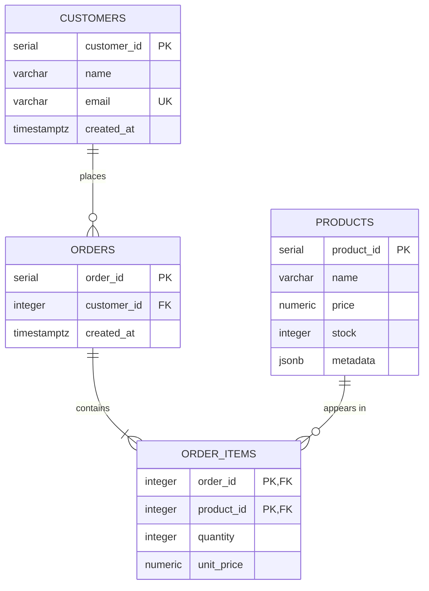

# E-Commerce Analytics Data Pipeline

Data pipeline for a fictional e-commerce store: PostgreSQL for customers, products and orders, Redis for caching popular products, and MongoDB for user sessions and carts.

## Setup

```bash
cp .env.example .env
docker compose up -d
python -m poetry install
python -m poetry run ecommerce setup      # create the tables
python -m poetry run ecommerce seed       # load sql/sample_data.sql (replaces all rows)
```

## Usage

CRUD functions live in `src/ecommerce_pipeline/repositories/`:

| Function | What it does |
|---|---|
| `add_customer(pool, name, email)` | Inserts a customer; a used email raises `DuplicateEmailError` |
| `add_product(pool, name, price, stock, metadata)` | Inserts a product; `metadata` is stored as JSONB |
| `create_order(pool, customer_id, {product_id: quantity})` | Creates an order in one transaction |
| `get_customer_orders(pool, customer_id)` | Lists a customer's orders with item count and total, newest first |

Every query uses `%s` parameters, so input is never pasted into SQL (no SQL injection).

### How `create_order` stays ACID

All steps run on one connection inside one transaction:

1. Check the customer exists.
2. Insert the order.
3. For each product, in id order: lock its row with `SELECT ... FOR UPDATE`, check the stock, insert the item with the current price as `unit_price`, and reduce the stock.
4. Commit.

If any step fails (unknown customer or product, not enough stock), the transaction is rolled back: no order, no items, and no stock change. `FOR UPDATE` stops two orders from selling the same last unit, and locking in id order stops two orders from deadlocking.

## ER diagram



## Schema

DDL: [sql/schema.sql](sql/schema.sql)

| Table | Why it exists | Constraints |
|---|---|---|
| `customers` | One row per customer | `email` is `UNIQUE` and `NOT NULL` |
| `products` | One row per product; sizes, colors etc. go in `metadata` (JSONB) | `price >= 0`, `stock >= 0` |
| `orders` | One row per order, linked to its customer | FK to `customers` |
| `order_items` | One row per product in an order (resolves the many-to-many between orders and products) | PK `(order_id, product_id)`, `quantity > 0`, FKs to `orders` and `products` |

## Normalization decisions

- **1NF:** every column holds one value. The products in an order are rows in `order_items`, not a list in `orders`.
- **2NF:** in `order_items`, `quantity` and `unit_price` depend on the whole key `(order_id, product_id)`, not on just one part.
- **3NF:** no column depends on another non-key column. Customer details live only in `customers`, and order totals are not stored: they are computed from `order_items`.
- **`order_items.unit_price`** is not a copy of `products.price`. It is the price at the time of purchase, so old orders keep their real total when a price changes.
- **`products.metadata`** is JSONB on purpose: attributes differ per product (a shirt has a size, a mug doesn't), so they don't fit fixed columns.
