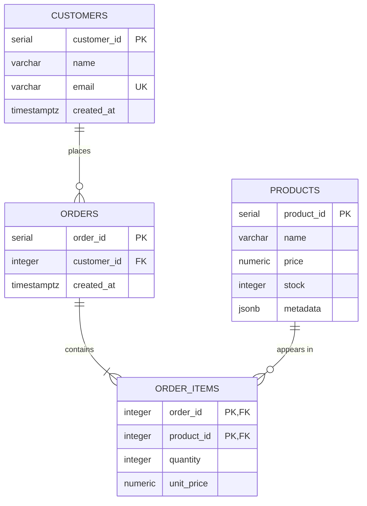

# E-Commerce Analytics Data Pipeline

Data pipeline for a fictional e-commerce store: PostgreSQL for customers, products and orders, Redis for caching popular products, and MongoDB for user sessions and carts.

## Setup

```bash
cp .env.example .env
docker compose up -d
python -m poetry install
python -m poetry run ecommerce setup      # create the tables and indexes
python -m poetry run ecommerce seed       # load sql/sample_data.sql (replaces all rows)
python -m poetry run ecommerce demo       # JSONB search, Mongo cart, order, Redis cache
python -m poetry run ecommerce report     # RANK() product ranking, CTE revenue per customer
python -m poetry run ecommerce benchmark  # EXPLAIN ANALYZE without and with indexes (replaces the data)
```

## Usage

CRUD functions live in `src/ecommerce_pipeline/repositories/`:

| Function | What it does |
|---|---|
| `add_customer(pool, name, email)` | Inserts a customer; a used email raises `DuplicateEmailError` |
| `add_product(pool, name, price, stock, metadata)` | Inserts a product; `metadata` is stored as JSONB |
| `create_order(pool, customer_id, {product_id: quantity})` | Creates an order in one transaction |
| `get_customer_orders(pool, customer_id)` | Lists a customer's orders with item count and total, newest first |

Every query uses `%s` parameters, so input is never pasted into SQL (no SQL injection).

### How `create_order` stays ACID

All steps run on one connection inside one transaction:

1. Check the customer exists.
2. Insert the order.
3. For each product, in id order: lock its row with `SELECT ... FOR UPDATE`, check the stock, insert the item with the current price as `unit_price`, and reduce the stock.
4. Commit.

If any step fails (unknown customer or product, not enough stock), the transaction is rolled back: no order, no items, and no stock change. `FOR UPDATE` stops two orders from selling the same last unit, and locking in id order stops two orders from deadlocking.

## SQL and NoSQL

Each store holds the data it fits best. `ecommerce demo` uses all three in one flow: it finds red products with JSONB, puts them in a MongoDB cart, orders the cart in PostgreSQL, and reads the best sellers through Redis.

### Redis: top 10 best sellers

`get_top_products(pool, redis)` in `cache/top_products.py` uses the cache-aside pattern:

1. Read the key `top_products` from Redis. On a **hit**, return it.
2. On a **miss**, run the SQL (units sold per product, top 10), store the JSON with a **300-second TTL**, and return it.

Why: the query scans every order item, but the answer changes slowly. The TTL means the list is at most 5 minutes old and needs no manual clearing.

### MongoDB: sessions and carts

`sessions/carts.py` keeps one document per user session in the `sessions` collection:

```json
{"_id": "9f1c...", "customer_id": 1, "cart": {"4": 2, "9": 1}, "updated_at": "2026-10-29T10:00:00Z"}
```

`add_to_cart` uses `$inc` (adding twice adds up), and `remove_from_cart` uses `$unset`. `get_cart` returns `{product_id: quantity}`, which goes straight into `create_order()`. Product ids are stored as strings because MongoDB keys must be strings.

Why: a cart changes often, is short-lived and has no fixed shape, so it doesn't need rows and transactions in PostgreSQL until it becomes an order.

### PostgreSQL JSONB: product metadata

`find_by_metadata(pool, filters)` in `repositories/products.py` uses the `@>` (contains) operator:

```sql
SELECT product_id, name, price, metadata FROM products WHERE metadata @> '{"colors": ["red"]}';
```

`{"category": "shoes", "sizes": ["40"]}` finds shoes that come in size 40. The filter is sent as a parameter, never pasted into the SQL.

## Reports

`ecommerce report` runs the two queries in `sql/queries/`:

- **`product_ranking.sql`:** a CTE totals units sold and revenue per product, then `RANK() OVER (ORDER BY units_sold DESC)` ranks them. Ties share a rank and the next rank is skipped (in the sample data, two products sold 4 units: both rank 4, the next ranks 6). Products never sold have 0 units and rank last.
- **`revenue_per_customer.sql`:** CTE `order_totals` gives one total per order, CTE `customer_revenue` adds them up per customer, then the result is joined to `customers`, highest revenue first.

## Optimization report

`ecommerce benchmark` loads the sample data plus bulk rows from `sql/bulk_data.sql` (20,000 customers, 50,000 products, 200,000 orders), drops the indexes, runs `EXPLAIN (ANALYZE, FORMAT JSON)`, creates the indexes and runs it again. Each time is the fastest of 3 runs.

| Query | Index | Before | After | Faster |
|---|---|---|---|---|
| `SELECT ... FROM orders WHERE customer_id = %s` | B-tree `idx_orders_customer_id` | Seq Scan, 11.79 ms | Bitmap Heap Scan, 0.021 ms | ~561× |
| `SELECT ... FROM products WHERE metadata @> '{"brand": "Brand-42"}'` | GIN `idx_products_metadata` | Seq Scan, 11.57 ms | Bitmap Heap Scan, 0.295 ms | ~39× |

Measured on PostgreSQL 16 in Docker Desktop (Windows), so the exact times differ per machine, but the plans don't.

**What the plans mean**

- **Seq Scan:** PostgreSQL reads every row of the table and throws most away. The cost grows with the table.
- **Bitmap Heap Scan** (with a Bitmap Index Scan below it): PostgreSQL asks the index which rows match, then reads only those. The cost grows with the number of matches (about 10 orders, about 50 products), not with the table.

**Why these indexes**

- **B-tree on `orders(customer_id)`:** PostgreSQL indexes primary keys on its own, but not foreign keys. `get_customer_orders()` and the revenue CTE look orders up by customer, so without this index every lookup scanned all 200,000 orders. B-tree is the right type for `=` and range lookups.
- **GIN on `products(metadata)`:** a B-tree can't look inside a JSON document. GIN indexes every key and value in the JSONB, which is exactly what `@>` (contains) needs, so `find_by_metadata()` no longer scans all 50,000 products.
- **Not indexed:** `products.price`, `orders.created_at` and the other columns. No query here filters on them, and every index slows down `INSERT` and `UPDATE`.

`setup` creates both indexes (`sql/indexes.sql`), so they're always there outside the benchmark. Run `ecommerce seed` after `benchmark` to go back to the small sample data.

## ER diagram



## Schema

DDL: [sql/schema.sql](sql/schema.sql)

| Table | Why it exists | Constraints |
|---|---|---|
| `customers` | One row per customer | `email` is `UNIQUE` and `NOT NULL` |
| `products` | One row per product; sizes, colors etc. go in `metadata` (JSONB) | `price >= 0`, `stock >= 0` |
| `orders` | One row per order, linked to its customer | FK to `customers` |
| `order_items` | One row per product in an order (resolves the many-to-many between orders and products) | PK `(order_id, product_id)`, `quantity > 0`, FKs to `orders` and `products` |

## Normalization decisions

- **1NF:** every column holds one value. The products in an order are rows in `order_items`, not a list in `orders`.
- **2NF:** in `order_items`, `quantity` and `unit_price` depend on the whole key `(order_id, product_id)`, not on just one part.
- **3NF:** no column depends on another non-key column. Customer details live only in `customers`, and order totals are not stored: they are computed from `order_items`.
- **`order_items.unit_price`** is not a copy of `products.price`. It is the price at the time of purchase, so old orders keep their real total when a price changes.
- **`products.metadata`** is JSONB on purpose: attributes differ per product (a shirt has a size, a mug doesn't), so they don't fit fixed columns.
