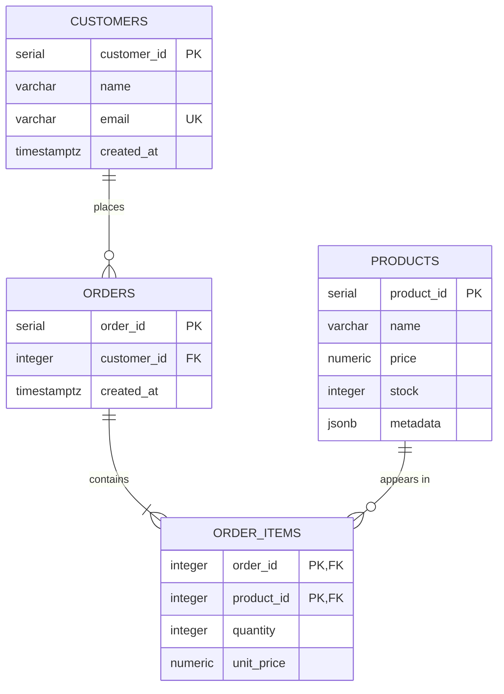

# E-Commerce Analytics Data Pipeline

A data pipeline for a fictional e-commerce store. PostgreSQL holds customers,
products and orders in a 3NF schema, Redis caches the best-selling products,
and MongoDB keeps user sessions and carts. Orders are created in one ACID
transaction, product metadata is searched with JSONB, reports use `RANK()` and
CTEs, and indexes are measured with `EXPLAIN ANALYZE`.


## Table of contents

1. [Features](#features)
2. [Setup](#setup)
3. [Usage](#usage)
4. [Test scenarios](#test-scenarios)
5. [Sample output](#sample-output)
6. [ER diagram](#er-diagram)
7. [Schema](#schema)
8. [Normalization decisions](#normalization-decisions)
9. [How `create_order` stays ACID](#how-create_order-stays-acid)
10. [SQL and NoSQL](#sql-and-nosql)
11. [Reports](#reports)
12. [Optimization report](#optimization-report)
13. [Testing](#testing)
14. [Project structure](#project-structure)
15. [Git workflow](#git-workflow)

## Features

- 3NF schema for customers, products, orders and order items, with primary
  keys, foreign keys and check constraints ([sql/schema.sql](sql/schema.sql))
- psycopg2 connection pool; every query uses `%s` parameters (no SQL injection)
- CRUD functions: `add_customer()`, `add_product()`, `create_order()`,
  `get_customer_orders()`
- `create_order()` in one ACID transaction with row locks (`FOR UPDATE`)
- PostgreSQL JSONB product metadata, searched with `@>` and a GIN index
- Redis cache for the top 10 best sellers (cache-aside, 5-minute TTL)
- MongoDB sessions and carts with pymongo
- `RANK()` product ranking and CTE revenue per customer
- `EXPLAIN ANALYZE` benchmark on 200,000 orders: B-tree ~561× and GIN ~39× faster
- Docker Compose for PostgreSQL 16, Redis 7 and MongoDB 7
- Its own log file (`output/ecommerce.log`)
- 73 tests, 100 % line and branch coverage, mypy strict, pre-commit hooks

## Setup

Requires Python 3.11+ and Docker.

```bash
git clone https://github.com/Molyceo12/AmaliTech_Python_Backend_Labs.git
cd AmaliTech_Python_Backend_Labs/DATABASE_FUNDAMENTALS/ecommerce-analytics-pipeline

cp .env.example .env              # local test credentials for the containers
docker compose up -d              # PostgreSQL, Redis, MongoDB

# with Poetry (creates .venv/ inside the project)
python -m pip install poetry
python -m poetry install
```

Without Poetry (`requirements.txt` is the pinned list exported from Poetry):

```bash
python -m venv .venv
.venv\Scripts\activate            # Linux/macOS: source .venv/bin/activate
python -m pip install -r requirements.txt
python -m pip install -e .
```

## Usage

```bash
python -m poetry run ecommerce setup      # create the tables and indexes
python -m poetry run ecommerce seed       # load sql/sample_data.sql (replaces all rows)
python -m poetry run ecommerce demo       # JSONB search, Mongo cart, order, Redis cache
python -m poetry run ecommerce report     # RANK() product ranking, CTE revenue per customer
python -m poetry run ecommerce benchmark  # EXPLAIN ANALYZE without and with indexes (replaces the data)
```

| Command | What it does |
|---|---|
| `setup` | Runs [sql/schema.sql](sql/schema.sql) and [sql/indexes.sql](sql/indexes.sql) |
| `seed` | Loads [sql/sample_data.sql](sql/sample_data.sql): 10 customers, 15 products, 20 orders |
| `demo` | Uses PostgreSQL, JSONB, MongoDB and Redis in one flow |
| `report` | Prints the top 10 of the product ranking and of revenue per customer |
| `benchmark` | Adds bulk rows, compares the queries without and with indexes |
| `-v`, `--verbose` | Also shows every log message in the terminal |

Exit codes: `0` success, `1` the command failed (a service is down, bad data),
`2` bad command-line value (from `argparse`).

CRUD functions live in `src/ecommerce_pipeline/repositories/`:

| Function | What it does |
|---|---|
| `add_customer(pool, name, email)` | Inserts a customer; a used email raises `DuplicateEmailError` |
| `add_product(pool, name, price, stock, metadata)` | Inserts a product; `metadata` is stored as JSONB |
| `create_order(pool, customer_id, {product_id: quantity})` | Creates an order in one transaction |
| `get_customer_orders(pool, customer_id)` | Lists a customer's orders with item count and total, newest first |

Every query uses `%s` parameters, so input is never pasted into SQL (no SQL injection).

## Test scenarios

Main ways to check the pipeline from the terminal (Docker running).

**1. Setup:** tables and both indexes created; running it again changes nothing.

```bash
python -m poetry run ecommerce setup
```

**2. Seed:** all rows replaced by the sample data (ids start at 1 again).

```bash
python -m poetry run ecommerce seed
```

**3. Demo:** 4 red products found with JSONB, 2 put in a MongoDB cart, the cart
ordered in PostgreSQL (stock goes down), then the top 10 read from the database
first and from Redis the second time.

```bash
python -m poetry run ecommerce demo
```

**4. Report:** Cotton T-Shirt ranks 1st with 12 units; two products tie at rank 4
and the next rank is 6.

```bash
python -m poetry run ecommerce report
```

**5. Benchmark:** both queries go from `Seq Scan` to an index scan. Run `seed`
afterwards to go back to the sample data.

```bash
python -m poetry run ecommerce benchmark
```

**6. Service down:** Redis on a wrong port gives a one-line error and exit code `1`.

```bash
REDIS_URL=redis://localhost:6390/0 python -m poetry run ecommerce demo
# Error: Cannot connect to Redis: Error 10061 connecting to localhost:6390. ...
```

**7. Unknown command:** `argparse` lists the valid commands, exit code `2`.

```bash
python -m poetry run ecommerce nope
```

## Sample output

`ecommerce demo` (after `seed`):

```
1. JSONB: products with metadata @> {'colors': ['red']}
     1  Cotton T-Shirt          15.00
     5  Running Shoes           80.00
     9  Bluetooth Speaker       55.00
    12  Throw Pillow            18.00

2. MongoDB: cart for customer 1
   session 61f9a3113b99478c80cb6417004ee498: {1: 1, 5: 1}

3. PostgreSQL: order the cart in one transaction
   created order 21
   order 21: 2 items, 95.00
   order 14: 4 items, 93.50
   order 4: 1 items, 60.00
   order 1: 3 items, 38.00

4. Redis: top 10 best sellers, asked twice
   from database: Cotton T-Shirt, Notebook, Ceramic Mug, ...
   from cache: Cotton T-Shirt, Notebook, Ceramic Mug, ...
```

`ecommerce report` (after `seed`):

```
Product ranking (RANK() by units sold)
    1  Cotton T-Shirt           12 units       180.00
    2  Notebook                  8 units        36.00
    3  Ceramic Mug               7 units        56.00
    4  Wireless Earbuds          4 units       240.00
    4  Phone Charger             4 units        50.00
    6  Hoodie                    3 units       105.00
    6  Kente Scarf               3 units        75.00
    6  Throw Pillow              3 units        54.00
    9  Denim Jeans               2 units        90.00
    9  Running Shoes             2 units       160.00

Revenue per customer (CTEs)
  Ama Mensah              4 orders       286.50
  Kofi Boateng            3 orders       276.00
  Kwame Asante            2 orders       185.50
  Akosua Addo             2 orders       173.00
  Abena Darko             2 orders       165.00
  Esi Owusu               2 orders       130.00
  Kojo Antwi              1 orders       120.00
  Kwesi Appiah            1 orders       105.00
  Adwoa Amoah             2 orders       103.00
  Yaw Ofori               2 orders        93.00
```

## ER diagram



## Schema

DDL: [sql/schema.sql](sql/schema.sql)

| Table | Why it exists | Constraints |
|---|---|---|
| `customers` | One row per customer | `email` is `UNIQUE` and `NOT NULL` |
| `products` | One row per product; sizes, colors etc. go in `metadata` (JSONB) | `price >= 0`, `stock >= 0` |
| `orders` | One row per order, linked to its customer | FK to `customers` |
| `order_items` | One row per product in an order (resolves the many-to-many between orders and products) | PK `(order_id, product_id)`, `quantity > 0`, FKs to `orders` and `products` |

## Normalization decisions

- **1NF:** every column holds one value. The products in an order are rows in `order_items`, not a list in `orders`.
- **2NF:** in `order_items`, `quantity` and `unit_price` depend on the whole key `(order_id, product_id)`, not on just one part.
- **3NF:** no column depends on another non-key column. Customer details live only in `customers`, and order totals are not stored: they are computed from `order_items`.
- **`order_items.unit_price`** is not a copy of `products.price`. It is the price at the time of purchase, so old orders keep their real total when a price changes.
- **`products.metadata`** is JSONB on purpose: attributes differ per product (a shirt has a size, a mug doesn't), so they don't fit fixed columns.

## How `create_order` stays ACID

All steps run on one connection inside one transaction:

1. Check the customer exists.
2. Insert the order.
3. For each product, in id order: lock its row with `SELECT ... FOR UPDATE`, check the stock, insert the item with the current price as `unit_price`, and reduce the stock.
4. Commit.

If any step fails (unknown customer or product, not enough stock), the transaction is rolled back: no order, no items, and no stock change. `FOR UPDATE` stops two orders from selling the same last unit, and locking in id order stops two orders from deadlocking.

## SQL and NoSQL

Each store holds the data it fits best. `ecommerce demo` uses all three in one flow: it finds red products with JSONB, puts them in a MongoDB cart, orders the cart in PostgreSQL, and reads the best sellers through Redis.

### Redis: top 10 best sellers

`get_top_products(pool, redis)` in `cache/top_products.py` uses the cache-aside pattern:

1. Read the key `top_products` from Redis. On a **hit**, return it.
2. On a **miss**, run the SQL (units sold per product, top 10), store the JSON with a **300-second TTL**, and return it.

Why: the query scans every order item, but the answer changes slowly. The TTL means the list is at most 5 minutes old and needs no manual clearing.

### MongoDB: sessions and carts

`sessions/carts.py` keeps one document per user session in the `sessions` collection:

```json
{"_id": "9f1c...", "customer_id": 1, "cart": {"4": 2, "9": 1}, "updated_at": "2026-10-29T10:00:00Z"}
```

`add_to_cart` uses `$inc` (adding twice adds up), and `remove_from_cart` uses `$unset`. `get_cart` returns `{product_id: quantity}`, which goes straight into `create_order()`. Product ids are stored as strings because MongoDB keys must be strings.

Why: a cart changes often, is short-lived and has no fixed shape, so it doesn't need rows and transactions in PostgreSQL until it becomes an order.

### PostgreSQL JSONB: product metadata

`find_by_metadata(pool, filters)` in `repositories/products.py` uses the `@>` (contains) operator:

```sql
SELECT product_id, name, price, metadata FROM products WHERE metadata @> '{"colors": ["red"]}';
```

`{"category": "shoes", "sizes": ["40"]}` finds shoes that come in size 40. The filter is sent as a parameter, never pasted into the SQL.

## Reports

`ecommerce report` runs the two queries in `sql/queries/`:

- **`product_ranking.sql`:** a CTE totals units sold and revenue per product, then `RANK() OVER (ORDER BY units_sold DESC)` ranks them. Ties share a rank and the next rank is skipped (in the sample data, two products sold 4 units: both rank 4, the next ranks 6). Products never sold have 0 units and rank last.
- **`revenue_per_customer.sql`:** CTE `order_totals` gives one total per order, CTE `customer_revenue` adds them up per customer, then the result is joined to `customers`, highest revenue first.

## Optimization report

`ecommerce benchmark` loads the sample data plus bulk rows from `sql/bulk_data.sql` (20,000 customers, 50,000 products, 200,000 orders), drops the indexes, runs `EXPLAIN (ANALYZE, FORMAT JSON)`, creates the indexes and runs it again. Each time is the fastest of 3 runs.

| Query | Index | Before | After | Faster |
|---|---|---|---|---|
| `SELECT ... FROM orders WHERE customer_id = %s` | B-tree `idx_orders_customer_id` | Seq Scan, 11.79 ms | Bitmap Heap Scan, 0.021 ms | ~561× |
| `SELECT ... FROM products WHERE metadata @> '{"brand": "Brand-42"}'` | GIN `idx_products_metadata` | Seq Scan, 11.57 ms | Bitmap Heap Scan, 0.295 ms | ~39× |

Measured on PostgreSQL 16 in Docker Desktop (Windows), so the exact times differ per machine, but the plans don't.

**What the plans mean**

- **Seq Scan:** PostgreSQL reads every row of the table and throws most away. The cost grows with the table.
- **Bitmap Heap Scan** (with a Bitmap Index Scan below it): PostgreSQL asks the index which rows match, then reads only those. The cost grows with the number of matches (about 10 orders, about 50 products), not with the table.

**Why these indexes**

- **B-tree on `orders(customer_id)`:** PostgreSQL indexes primary keys on its own, but not foreign keys. `get_customer_orders()` and the revenue CTE look orders up by customer, so without this index every lookup scanned all 200,000 orders. B-tree is the right type for `=` and range lookups.
- **GIN on `products(metadata)`:** a B-tree can't look inside a JSON document. GIN indexes every key and value in the JSONB, which is exactly what `@>` (contains) needs, so `find_by_metadata()` no longer scans all 50,000 products.
- **Not indexed:** `products.price`, `orders.created_at` and the other columns. No query here filters on them, and every index slows down `INSERT` and `UPDATE`.

`setup` creates both indexes (`sql/indexes.sql`), so they're always there outside the benchmark. Run `ecommerce seed` after `benchmark` to go back to the small sample data.

## Testing

```bash
python -m poetry run pytest                                   # all tests
python -m poetry run pytest --cov --cov-report=term-missing   # with coverage
python -m poetry run python -m pre_commit run --all-files     # Black, ruff, pylint, mypy
```

| Folder | What is tested |
|---|---|
| `tests/unit/` | settings, log file, pool and rollback, schema and seed files, every repository (mocked cursor), order errors, Redis cache hit and miss, Mongo carts, JSONB filter, reports, benchmark (fake `EXPLAIN` JSON), demo, CLI commands and exit codes |
| `tests/integration/` | the real Docker services: tables and indexes exist, sample data, ACID order (rollback leaves stock unchanged), JSONB search, Redis TTL, Mongo carts, report numbers, plans switch from `Seq Scan` to an index scan |

73 tests, 100 % line and branch coverage ([reports/coverage.txt](reports/coverage.txt)).
Integration tests are skipped when Docker is not running, so the unit tests
still run anywhere.

## Project structure

```
ecommerce-analytics-pipeline/
├── src/ecommerce_pipeline/
│   ├── cli.py                  # command line: setup, seed, demo, report, benchmark
│   ├── config.py               # settings loaded from .env
│   ├── exceptions.py           # EcommerceError and subclasses
│   ├── logging_config.py       # the pipeline's own log: file + terminal
│   ├── demo.py                 # PostgreSQL, JSONB, MongoDB and Redis in one flow
│   ├── db/                     # pool, Redis/Mongo clients, schema and seed runners
│   ├── repositories/           # customers, products (JSONB), orders (ACID)
│   ├── cache/                  # Redis top 10 best sellers
│   ├── sessions/               # MongoDB sessions and carts
│   └── analytics/              # RANK/CTE reports, EXPLAIN ANALYZE benchmark
├── sql/
│   ├── schema.sql              # 3NF DDL
│   ├── indexes.sql             # B-tree and GIN indexes
│   ├── drop_indexes.sql        # used by the benchmark's "before" run
│   ├── sample_data.sql         # small sample data
│   ├── bulk_data.sql           # 200,000 orders for the benchmark
│   └── queries/                # product_ranking.sql, revenue_per_customer.sql
├── tests/                      # unit/ and integration/
├── reports/coverage.txt
├── docker-compose.yml, .env.example
├── pyproject.toml, poetry.lock, requirements.txt
├── CHANGELOG.md
└── README.md
```

## Git workflow

The repository is shared by several labs, so every branch of this lab starts
with `ecommerce-pipeline/` and merges into the shared `main` through a pull request:

| Branch | Content |
|---|---|
| `ecommerce-pipeline/feature/project-setup` | Poetry, pre-commit hooks, settings, exceptions, logging |
| `ecommerce-pipeline/feature/docker-schema` | Docker services, 3NF schema, ER diagram, pool, `setup` |
| `ecommerce-pipeline/feature/crud-transactions` | repositories, ACID `create_order`, sample data, `seed` |
| `ecommerce-pipeline/feature/nosql-jsonb` | Redis cache, MongoDB carts, JSONB search, `demo` |
| `ecommerce-pipeline/feature/analytics-indexes` | `RANK()` and CTE reports, B-tree and GIN indexes, benchmark |
| `ecommerce-pipeline/feature/tests-docs` | test gaps, coverage report, `requirements.txt`, documentation |
