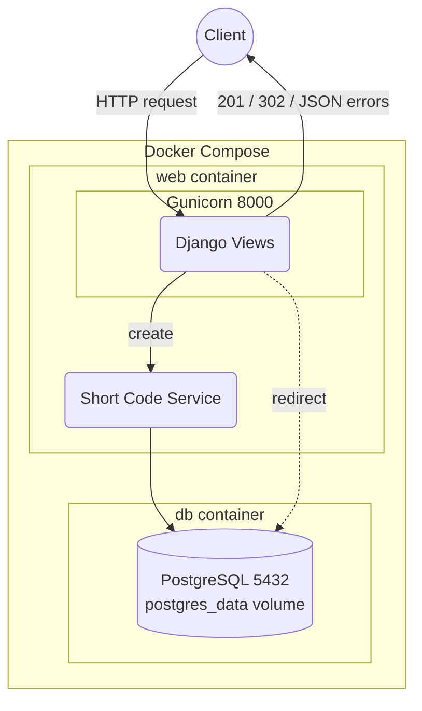

# URL Shortener Microservice

A URL shortener (like Bitly) built with Django and Django REST Framework. It
turns a long URL into a short code and redirects the short code back to the
original URL.


## Architecture



## Setup

```bash
git clone https://github.com/Molyceo12/AmaliTech_Python_Backend_Labs.git
cd AmaliTech_Python_Backend_Labs/DJANGO/url-shortener-microservice
cp .env.example .env              # SECRET_KEY, ALLOWED_HOSTS, POSTGRES_*
```

With Docker (Gunicorn + PostgreSQL 16):

```bash
docker compose up --build -d
```

Without Docker (SQLite):

```bash
python -m pip install poetry
python -m poetry install
python -m poetry run python manage.py migrate
python -m poetry run python manage.py runserver
```

Tests and code checks:

```bash
python -m poetry run python -m pytest --cov                 # run the tests with coverage
python -m poetry run python -m pre_commit run --all-files   # pre-commit hooks: ruff, Black, pylint, mypy
```

Swagger UI: http://localhost:8000/api/docs/

## Users

`accounts.User` (`AUTH_USER_MODEL`) extends Django's `AbstractUser`:

| Field | Rule |
|---|---|
| `email` | unique, required, saved lowercase; used to log in |
| `tier` | `free` (default), `premium` or `admin` |
| `is_premium` | set from `tier` on save (`premium` → True) |

`tier = admin` gives no admin rights: `is_staff` / `is_superuser` still decide that.

```bash
python -m poetry run python manage.py createsuperuser   # asks for email, username, password
```

Coming from Module 5? The user model changed, so start the dev databases fresh
once (lab data is lost):

```bash
rm db.sqlite3                  # SQLite
docker compose down -v         # Docker PostgreSQL volume
```

## API endpoints

| Method | Route | What it does |
|---|---|---|
| `POST` | `/api/v1/urls/` | creates a short URL |
| `GET` | `/<short_code>/` | redirects to the original URL |
| `GET` | `/api/docs/` | Swagger UI |
| `GET` | `/api/schema/` | OpenAPI schema |

```bash
curl -X POST http://localhost:8000/api/v1/urls/ \
     -H "Content-Type: application/json" \
     -d '{"original_url": "https://www.djangoproject.com/start/"}'
```

```json
{
  "status_code": 201,
  "message": "Created",
  "detail": {
    "original_url": "https://www.djangoproject.com/start/",
    "short_code": "M1gmaSk",
    "short_url": "http://localhost:8000/M1gmaSk/",
    "created_at": "2026-10-30T12:23:36.052396Z"
  }
}
```

| Status | When |
|---|---|
| `201` | short URL created |
| `302` | redirect to the original URL |
| `400` | invalid or missing URL |
| `404` | unknown short code or route |
| `405` | wrong HTTP method |
| `500` | server error (logged, never shown to the client) |

### Response format

Every JSON response, success or error, has the same 3 keys:

| Key | Value |
|---|---|
| `status_code` | the HTTP status, e.g. `201` |
| `message` | its HTTP reason, e.g. `Created`, `Not Found` |
| `detail` | the data, or the error (a field dict for `400`) |

```json
{"status_code": 404, "message": "Not Found", "detail": "Short code not found."}
```

A renderer (`url_shortener/renderers.py`) adds this wrapper to every API response,
so new endpoints and new status codes need no extra code. Django's own error pages
(`400`, `403`, `404`, `500`) use the same shape. Only a `302` redirect and a
`204` (no body allowed) are not wrapped.

### Versioning

The API lives under `/api/v1/`, set once in `url_shortener/urls.py`. The redirect
`/<short_code>/` is not versioned, so short links stay short and never break when
the API version changes.
