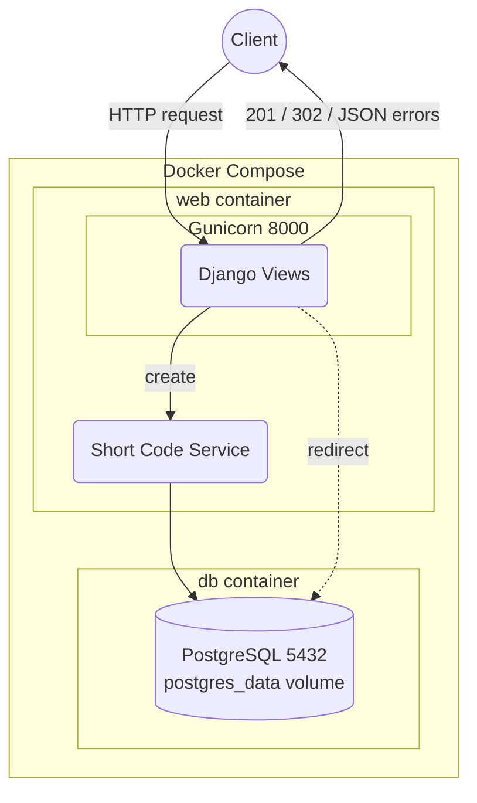
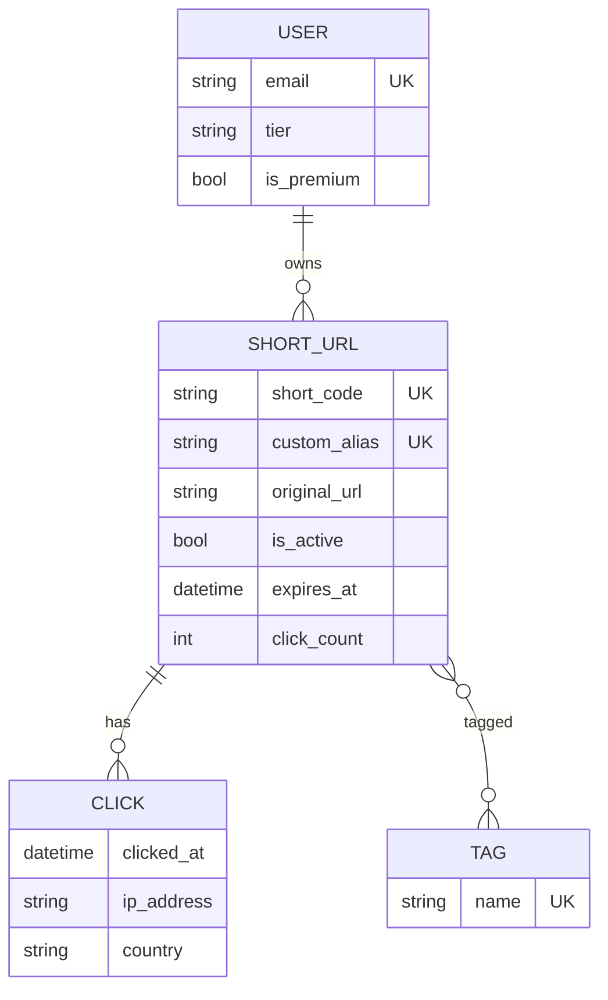

# URL Shortener Microservice

A URL shortener (like Bitly) built with Django and Django REST Framework. It
turns a long URL into a short code and redirects the short code back to the
original URL.


## Architecture



## Setup

```bash
git clone https://github.com/Molyceo12/AmaliTech_Python_Backend_Labs.git
cd AmaliTech_Python_Backend_Labs/DJANGO/url-shortener-microservice
cp .env.example .env              # SECRET_KEY, ALLOWED_HOSTS, POSTGRES_*
```

With Docker (Gunicorn + PostgreSQL 16):

```bash
docker compose up --build -d
```

Without Docker (SQLite):

```bash
python -m pip install poetry
python -m poetry install
python -m poetry run python manage.py migrate
python -m poetry run python manage.py runserver
```

Tests and code checks:

```bash
python -m poetry run python -m pytest --cov                 # run the tests with coverage
python -m poetry run python -m pre_commit run --all-files   # pre-commit hooks: ruff, Black, pylint, mypy
```

Swagger UI: http://localhost:8000/api/docs/

## Users

`accounts.User` (`AUTH_USER_MODEL`) extends Django's `AbstractUser`:

| Field | Rule |
|---|---|
| `email` | unique, required, saved lowercase; used to log in |
| `tier` | `free` (default), `premium` or `admin` |
| `is_premium` | set from `tier` on save (`premium` → True) |

`tier = admin` gives no admin rights: `is_staff` / `is_superuser` still decide that.

```bash
python -m poetry run python manage.py createsuperuser   # asks for email, username, password
```

Coming from Module 5? The user model changed, so start the dev databases fresh
once (lab data is lost):

```bash
rm db.sqlite3                  # SQLite
docker compose down -v         # Docker PostgreSQL volume
```

## URL data

| Model | Holds |
|---|---|
| `ShortURL` | `original_url`, `short_code`, `custom_alias`, `owner`, `is_active`, `expires_at`, `title`, `description`, `favicon`, `click_count`, `tags` |
| `Tag` | unique `name`, saved lowercase (many-to-many with `ShortURL`) |
| `Click` | one visit: time, IP, city, country, user agent, referrer (deleted with its URL) |

Named queries: `ShortURL.objects.active_urls()`, `.expired_urls()`, `.popular_urls()`.
Indexes on `created_at`, `expires_at` and `Click (short_url, clicked_at)`;
the database refuses an `expires_at` before `created_at`.



Migrations:

```bash
python -m poetry run python manage.py makemigrations   # after a model change
python -m poetry run python manage.py migrate          # apply them
python -m poetry run python manage.py showmigrations   # what is applied
```

## Seeders

`seed_dev` adds a user (`seed@example.com`, premium), 4 tags, 5 URLs (active, popular,
alias `daily-news`, switched off, expired) and 12 clicks. Running it again adds nothing.
It refuses when `DEBUG` is off, so it never touches production.

```bash
python -m poetry run python manage.py seed_dev
docker compose exec -e DJANGO_SETTINGS_MODULE=url_shortener.settings.dev web python manage.py seed_dev
```

The seed user's password comes from `SEED_USER_PASSWORD` in `.env`; left empty, the
user exists but can't log in.

## Engineering decisions

- **Email login + tier:** custom `User` from the start; `tier=admin` gives no admin rights.
- **Alias checked against codes too:** `/<x>/` resolves both, so they can't clash (`409`).
- **Inactive → `404`, expired → `410`:** a switched-off link looks unknown; an expired one says why.
- **Click counter with `F()`:** the database adds 1, so clicks at the same moment all count.
- **No N+1:** `select_related("owner")` + `prefetch_related("tags")` on the list,
  `annotate(Count("clicks"))` on the detail; a test checks the query count.
- **Indexes only where queries filter or sort:** not on `is_active` (2 values, little gain).
- **Click IP from `REMOTE_ADDR` only:** `X-Forwarded-For` is sent by the client and can be faked.
- **Seeders as a command, not a migration:** migrations run in production too.

## API endpoints

| Method | Route | What it does |
|---|---|---|
| `POST` | `/api/v1/urls/` | creates a short URL (optional alias, expiry, title, description, tags) |
| `GET` | `/api/v1/urls/` | lists short URLs, 20 per page |
| `GET` | `/api/v1/urls/<short_code>/` | shows one URL with `total_clicks` |
| `PUT` / `PATCH` | `/api/v1/urls/<short_code>/` | changes a URL |
| `DELETE` | `/api/v1/urls/<short_code>/` | deletes a URL |
| `GET` | `/<short_code or alias>/` | redirects to the original URL and records a click |
| `GET` | `/api/docs/` | Swagger UI |
| `GET` | `/api/schema/` | OpenAPI schema |

List filters: `?status=active`, `?status=expired`, `?ordering=popular` (can be combined).

```bash
curl -X POST http://localhost:8000/api/v1/urls/ \
     -H "Content-Type: application/json" \
     -d '{"original_url": "https://www.djangoproject.com/start/", "custom_alias": "django", "tags": ["docs"]}'
```

```json
{
  "status_code": 201,
  "message": "Created",
  "detail": {
    "original_url": "https://www.djangoproject.com/start/",
    "short_code": "M1gmaSk",
    "short_url": "http://localhost:8000/M1gmaSk/",
    "custom_alias": "django",
    "title": "",
    "description": "",
    "expires_at": null,
    "is_active": true,
    "tags": ["docs"],
    "owner": null,
    "click_count": 0,
    "created_at": "2026-11-05T12:23:36.052396Z",
    "updated_at": "2026-11-05T12:23:36.052412Z"
  }
}
```

`owner` is read-only and stays empty until login arrives (Module 7).

| Status | When |
|---|---|
| `200` | URL listed, shown or changed |
| `201` | short URL created |
| `204` | short URL deleted |
| `302` | redirect to the original URL |
| `400` | invalid URL, past expiry, reserved or bad alias, unknown filter |
| `404` | unknown or switched-off short code, unknown route |
| `405` | wrong HTTP method |
| `409` | custom alias already taken |
| `410` | short URL expired |
| `500` | server error (logged, never shown to the client) |

### Response format

Every JSON response, success or error, has the same 3 keys:

| Key | Value |
|---|---|
| `status_code` | the HTTP status, e.g. `201` |
| `message` | its HTTP reason, e.g. `Created`, `Not Found` |
| `detail` | the data, or the error (a field dict for `400`) |

```json
{"status_code": 404, "message": "Not Found", "detail": "Short code not found."}
```

A renderer (`url_shortener/renderers.py`) adds this wrapper to every API response,
so new endpoints and new status codes need no extra code. Django's own error pages
(`400`, `403`, `404`, `500`) use the same shape. Only a `302` redirect and a
`204` (no body allowed) are not wrapped.

### Versioning

The API lives under `/api/v1/`, set once in `url_shortener/urls.py`. The redirect
`/<short_code>/` is not versioned, so short links stay short and never break when
the API version changes.
