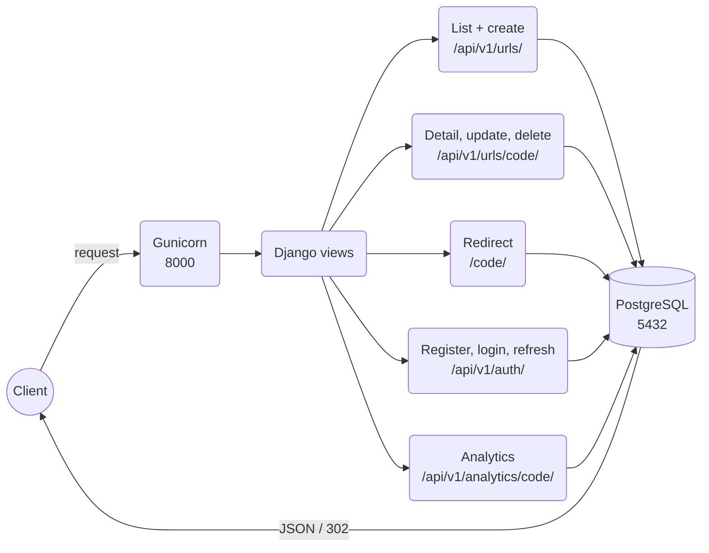

# URL Shortener Microservice

A URL shortener (like Bitly) built with Django and Django REST Framework. It
turns a long URL into a short code and redirects the short code back to the
original URL.


## Architecture



### Services overview

- **Web (`web`, prod)**: Gunicorn runs Django on port `8000`; **`web-dev`** runs the
  same app with `runserver` and dev settings instead.
  - **URL API** (`/api/v1/urls/`, login needed): create, list your own URLs (filters,
    tag search, 20 per page), detail with click stats; only the owner can update or
    delete.
  - **Redirect** (`/<code or alias>/`): sends the visitor on (`302`) and saves a click.
  - **Analytics** (`/api/v1/analytics/<code>/`, Premium / Admin, own URLs): clicks
    per day and per country.
  - **Auth API** (`/api/v1/auth/`): register, log in for JWT tokens (5 tries per
    minute), refresh the access token.
  - **Swagger** (`/api/docs/`) and **Django admin** (`/admin/`).
  - **Renderer**: gives every JSON response the same `{status_code, message, detail}` shape.
  - **Logs**: console and `logs/app.log`, kept in the `app_logs` volume.
- **PostgreSQL (`db`)**: stores users, short URLs, tags and clicks in the
  `postgres_data` volume; open it from your PC on port `5433` (e.g. pgAdmin).

## Setup

```bash
git clone https://github.com/Molyceo12/AmaliTech_Python_Backend_Labs.git
cd AmaliTech_Python_Backend_Labs/DJANGO/url-shortener-microservice
cp .env.example .env              # SECRET_KEY, ALLOWED_HOSTS, POSTGRES_*
```

With Docker (PostgreSQL 16), pick prod or dev; both use port `8000`, so run one:

```bash
docker compose --profile prod up --build -d   # prod: Gunicorn, prod settings
docker compose --profile dev up --build       # dev: runserver, DEBUG on (admin CSS works)
docker compose run --rm seed                  # add the sample data (seeders)
docker compose --profile prod --profile dev down -v   # stop and delete the database
```

Without Docker (SQLite):

```bash
python -m pip install poetry
python -m poetry install
python -m poetry run python manage.py migrate
python -m poetry run python manage.py runserver
```

Tests and code checks:

```bash
python -m poetry run python -m pytest --cov                 # run the tests with coverage
python -m poetry run python -m pytest tests/unit          # unit tests only
python -m poetry run python -m pytest tests/integration   # API + redirect tests only
python -m poetry run python -m pre_commit run --all-files   # pre-commit hooks: ruff, Black, pylint, mypy
```

Admin user and sample data (seeders, dev only):

```bash
python -m poetry run python manage.py createsuperuser   # email, username, password
python -m poetry run python manage.py seed_dev          # 2 users (Premium + Free), tags, 5 URLs, clicks
```

Swagger UI: http://localhost:8000/api/docs/

Logs go to the console and to `logs/app.log` (5 MB per file, last 3 kept;
gitignored). In Docker the file lives in the `app_logs` volume:

```bash
docker compose logs -f web                          # console logs
docker compose exec web tail -f logs/app.log        # the log file
```

## API endpoints

| Method | Route | What it does |
|---|---|---|
| `POST` | `/api/v1/auth/register/` | creates an account (`email`, `username`, `password`); new users are `free` |
| `POST` | `/api/v1/auth/login/` | `email` + `password` → `access` (15 min) and `refresh` (1 day) tokens; 5 tries per minute |
| `POST` | `/api/v1/auth/refresh/` | `refresh` → a new `access` token |
| `POST` | `/api/v1/urls/` | creates a short URL owned by you (optional alias, expiry, title, description, tags) |
| `GET` | `/api/v1/urls/` | lists your own short URLs, 20 per page |
| `GET` | `/api/v1/urls/<short_code or alias>/` | shows one URL with `total_clicks` (+ `clicks_by_country` for Premium / Admin) |
| `PUT` / `PATCH` | `/api/v1/urls/<short_code or alias>/` | changes a URL (owner only) |
| `DELETE` | `/api/v1/urls/<short_code or alias>/` | deletes a URL (owner only) |
| `GET` | `/api/v1/analytics/<short_code or alias>/` | total clicks, clicks per day and per country (Premium / Admin, own URLs) |
| `GET` | `/<short_code or alias>/` | redirects to the original URL and records a click |
| `GET` | `/api/docs/` | Swagger UI |
| `GET` | `/api/schema/` | OpenAPI schema |

List filters: `?status=active`, `?status=expired`, `?ordering=popular`, `?tag=<name>`
(can be combined).

Tier rules (`403` when broken):

| Feature | Free | Premium / Admin |
|---|---|---|
| Active URLs (switched on, not expired) | max 10 | unlimited |
| Custom alias | no | yes |
| Analytics | no | yes |

Only `http` and `https` URLs are accepted; other schemes get `400`.

Using the token: every `/api/v1/urls/` call needs a login (no token → `401`; someone
else's URL → `403` on change or delete). Log in, then send the `access` token as
`Authorization: Bearer <access>`. Register, login, refresh and the redirect are open. In Swagger, click **Authorize** and paste the
`access` token. When it expires, get a new one from `/api/v1/auth/refresh/`.
