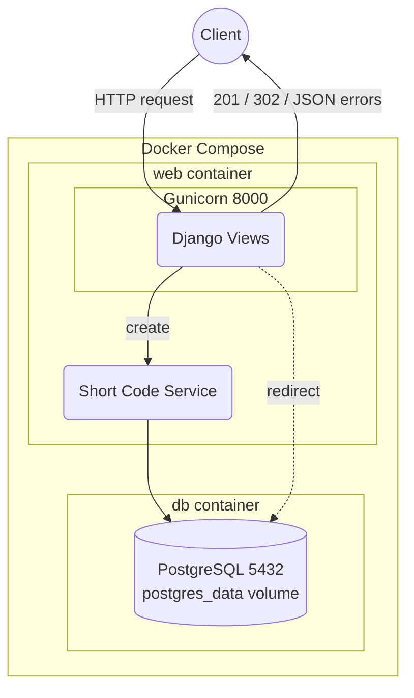

# URL Shortener Microservice

A URL shortener (like Bitly) built with Django and Django REST Framework. It
turns a long URL into a short code and redirects the short code back to the
original URL.


## Architecture



## Setup

```bash
git clone https://github.com/Molyceo12/AmaliTech_Python_Backend_Labs.git
cd AmaliTech_Python_Backend_Labs/DJANGO/url-shortener-microservice
cp .env.example .env              # SECRET_KEY, ALLOWED_HOSTS, POSTGRES_*
```

With Docker (Gunicorn + PostgreSQL 16):

```bash
docker compose up --build -d
```

Without Docker (SQLite):

```bash
python -m pip install poetry
python -m poetry install
python -m poetry run python manage.py migrate
python -m poetry run python manage.py runserver
```

Tests and code checks:

```bash
python -m poetry run python -m pytest --cov                 # run the tests with coverage
python -m poetry run python -m pytest tests/unit          # unit tests only
python -m poetry run python -m pytest tests/integration   # API + redirect tests only
python -m poetry run python -m pre_commit run --all-files   # pre-commit hooks: ruff, Black, pylint, mypy
```

Admin user and sample data (seeders, dev only):

```bash
python -m poetry run python manage.py createsuperuser   # email, username, password
python -m poetry run python manage.py seed_dev          # 1 user, tags, 5 URLs, clicks
```

Swagger UI: http://localhost:8000/api/docs/

Logs go to the console and to `logs/app.log` (5 MB per file, last 3 kept;
gitignored). In Docker the file lives in the `app_logs` volume:

```bash
docker compose logs -f web                          # console logs
docker compose exec web tail -f logs/app.log        # the log file
```

## API endpoints

| Method | Route | What it does |
|---|---|---|
| `POST` | `/api/v1/urls/` | creates a short URL (optional alias, expiry, title, description, tags) |
| `GET` | `/api/v1/urls/` | lists short URLs, 20 per page |
| `GET` | `/api/v1/urls/<short_code>/` | shows one URL with `total_clicks` and `clicks_by_country` |
| `PUT` / `PATCH` | `/api/v1/urls/<short_code>/` | changes a URL |
| `DELETE` | `/api/v1/urls/<short_code>/` | deletes a URL |
| `GET` | `/<short_code or alias>/` | redirects to the original URL and records a click |
| `GET` | `/api/docs/` | Swagger UI |
| `GET` | `/api/schema/` | OpenAPI schema |

List filters: `?status=active`, `?status=expired`, `?ordering=popular` (can be combined).

### Requests and responses

`...` stands for the other URL fields shown in **Create**.

**Create** `POST /api/v1/urls/`

```json
{"original_url": "https://www.djangoproject.com/start/", "custom_alias": "django", "tags": ["docs"]}
```

`201`:

```json
{
  "status_code": 201,
  "message": "Short URL created.",
  "detail": {
    "original_url": "https://www.djangoproject.com/start/",
    "short_code": "M1gmaSk",
    "short_url": "http://localhost:8000/M1gmaSk/",
    "custom_alias": "django",
    "title": "",
    "description": "",
    "expires_at": null,
    "is_active": true,
    "tags": ["docs"],
    "owner": null,
    "click_count": 0,
    "created_at": "2026-11-05T12:23:36.052396Z",
    "updated_at": "2026-11-05T12:23:36.052412Z"
  }
}
```

Only `original_url` is required. `owner`, `short_code`, `click_count` and the dates are
read-only (`owner` stays empty until login, Module 7).

**List** `GET /api/v1/urls/?status=active&ordering=popular&page=1`

`200`:

```json
{
  "status_code": 200,
  "message": "Short URLs loaded.",
  "detail": {
    "count": 1,
    "next": null,
    "previous": null,
    "results": [{"short_code": "M1gmaSk", "original_url": "https://www.djangoproject.com/start/", "...": "..."}]
  }
}
```

**Detail** `GET /api/v1/urls/M1gmaSk/`

`200`:

```json
{
  "status_code": 200,
  "message": "Short URL loaded.",
  "detail": {
    "short_code": "M1gmaSk",
    "...": "...",
    "total_clicks": 3,
    "clicks_by_country": [{"country": "Rwanda", "total": 2}, {"country": "", "total": 1}]
  }
}
```

An empty `country` means unknown (no geo lookup yet).

**Update** `PUT /api/v1/urls/M1gmaSk/` (all fields) or `PATCH` (only what changes)

```json
{"title": "Django start", "is_active": false}
```

`200`:

```json
{"status_code": 200, "message": "Short URL updated.", "detail": {"title": "Django start", "is_active": false, "...": "..."}}
```

**Delete** `DELETE /api/v1/urls/M1gmaSk/`: `204`, no body.

**Redirect** `GET /M1gmaSk/` or `GET /django/`: `302` with `Location: https://www.djangoproject.com/start/`
(no JSON body). A click is saved.

**Error** example, `POST /api/v1/urls/` with `{"original_url": "not a url"}`:

```json
{"status_code": 400, "message": "Enter a valid URL.", "detail": {"original_url": ["Enter a valid URL."]}}
```

| Status | When |
|---|---|
| `200` | URL listed, shown or changed |
| `201` | short URL created |
| `204` | short URL deleted |
| `302` | redirect to the original URL |
| `400` | invalid URL, past expiry, reserved or bad alias, unknown filter |
| `404` | unknown or switched-off short code, unknown route |
| `405` | wrong HTTP method |
| `409` | custom alias already taken |
| `410` | short URL expired |
| `500` | server error (logged, never shown to the client) |

### Response format

Every JSON response, success or error, has the same 3 keys:

| Key | Value |
|---|---|
| `status_code` | the HTTP status, e.g. `201` |
| `message` | short text to show as a toast, e.g. `Short URL created.`, `Short code not found.` |
| `detail` | the data, or the error (a field dict for `400`) |

```json
{"status_code": 404, "message": "Short code not found.", "detail": "Short code not found."}
```

Where `message` comes from:

1. success: the view's `success_messages` for the method (e.g. `POST` → `Short URL created.`)
2. error: the first error text (e.g. `Enter a valid URL.`)
3. otherwise: the HTTP reason (e.g. `OK`)

A renderer (`url_shortener/renderers.py`) adds this wrapper to every API response,
so new endpoints and new status codes need no extra code. Django's own error pages
(`400`, `403`, `404`, `500`) use the same shape. Only a `302` redirect and a
`204` (no body allowed) are not wrapped.

### Versioning

The API lives under `/api/v1/`, set once in `url_shortener/urls.py`. The redirect
`/<short_code>/` is not versioned, so short links stay short and never break when
the API version changes.
