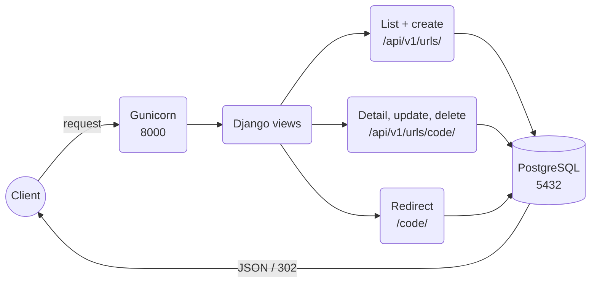

# URL Shortener Microservice

A URL shortener (like Bitly) built with Django and Django REST Framework. It
turns a long URL into a short code and redirects the short code back to the
original URL.


## Architecture



### Services overview

- **Web (`web`)**: Gunicorn runs Django on port `8000`.
  - **URL API** (`/api/v1/urls/`): create, list (filters, 20 per page), detail with
    click stats, update and delete short URLs.
  - **Redirect** (`/<code or alias>/`): sends the visitor on (`302`) and saves a click.
  - **Swagger** (`/api/docs/`) and **Django admin** (`/admin/`).
  - **Renderer**: gives every JSON response the same `{status_code, message, detail}` shape.
  - **Logs**: console and `logs/app.log`, kept in the `app_logs` volume.
- **PostgreSQL (`db`)**: stores users, short URLs, tags and clicks in the
  `postgres_data` volume; open it from your PC on port `5433` (e.g. pgAdmin).

## Setup

```bash
git clone https://github.com/Molyceo12/AmaliTech_Python_Backend_Labs.git
cd AmaliTech_Python_Backend_Labs/DJANGO/url-shortener-microservice
cp .env.example .env              # SECRET_KEY, ALLOWED_HOSTS, POSTGRES_*
```

With Docker (Gunicorn + PostgreSQL 16):

```bash
docker compose up --build -d
```

Without Docker (SQLite):

```bash
python -m pip install poetry
python -m poetry install
python -m poetry run python manage.py migrate
python -m poetry run python manage.py runserver
```

Tests and code checks:

```bash
python -m poetry run python -m pytest --cov                 # run the tests with coverage
python -m poetry run python -m pytest tests/unit          # unit tests only
python -m poetry run python -m pytest tests/integration   # API + redirect tests only
python -m poetry run python -m pre_commit run --all-files   # pre-commit hooks: ruff, Black, pylint, mypy
```

Admin user and sample data (seeders, dev only):

```bash
python -m poetry run python manage.py createsuperuser   # email, username, password
python -m poetry run python manage.py seed_dev          # 1 user, tags, 5 URLs, clicks
```

Swagger UI: http://localhost:8000/api/docs/

Logs go to the console and to `logs/app.log` (5 MB per file, last 3 kept;
gitignored). In Docker the file lives in the `app_logs` volume:

```bash
docker compose logs -f web                          # console logs
docker compose exec web tail -f logs/app.log        # the log file
```

## API endpoints

| Method | Route | What it does |
|---|---|---|
| `POST` | `/api/v1/urls/` | creates a short URL (optional alias, expiry, title, description, tags) |
| `GET` | `/api/v1/urls/` | lists short URLs, 20 per page |
| `GET` | `/api/v1/urls/<short_code>/` | shows one URL with `total_clicks` and `clicks_by_country` |
| `PUT` / `PATCH` | `/api/v1/urls/<short_code>/` | changes a URL |
| `DELETE` | `/api/v1/urls/<short_code>/` | deletes a URL |
| `GET` | `/<short_code or alias>/` | redirects to the original URL and records a click |
| `GET` | `/api/docs/` | Swagger UI |
| `GET` | `/api/schema/` | OpenAPI schema |

List filters: `?status=active`, `?status=expired`, `?ordering=popular` (can be combined).
